 

 

 

 

 

  <a href="https://spandanareddib.github.io">portfolio</a> /
  <a href="https://www.linkedin.com/in/spandana-bogala">linkedin</a> /
  <a href="mailto:spandanareddib@gmail.com">email</a>

